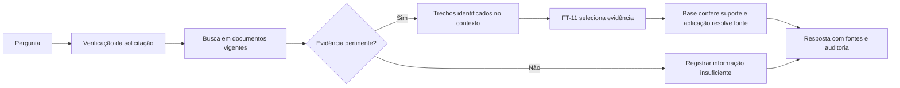

> **Atualização de integração — 16/10/2026.** O piloto documental congelado é usado pela aplicação FT-11; a cadeia factual de prontuário e o grafo LangGraph são extensões separadas. Descrições de API simulada/Ollama e etapas futuras nas seções históricas referem-se ao planejamento anterior. Fluxo e limites vigentes: [relatório técnico](RELATORIO_TECNICO.md), [README](../README.md) e [guia](GUIA_VALIDACAO.md). Não editar corpus/módulos aceitos nem herdar métricas do piloto para prompts novos.

# Planejamento do RAG — 07/10/2026

**Progresso em 12/10/2026:** preparação documental RAG-09 concluída nos critérios do piloto. BM25 sobre 15 seções integrais, FT-11 selecionado, verificador comum na base sem adapter e contexto completo, incluindo última linha. Validação final: ambos com RAG 22/24 completas, duas parciais e todos os 16 casos especiais corretos. [Teste final](../llm/artifacts/experiments/20261012T184438077141Z_rag09_test/review.md): FT-11+RAG 19/24 completas, duas parciais e três abstenções indevidas; base+RAG 18/24, três parciais e mesmas abstenções. Ambos 8/8 ausências, 4/4 conflitos e 4/4 instruções hostis; 24/24 spans entregues e todos os caracteres úteis no prompt. Zero erros/omissões, orçamento 3.072/reserva 256, pico VRAM 7,92 GiB. 42 testes de software aprovados; [CLI recarregada em processo novo](../llm/artifacts/experiments/20261012T190305897293Z_rag_query_v3/review.md) retorna ambas as assinaturas com fonte/offsets corretos e sem consultar splits. Recibo ativo vincula módulos/índice/pacotes/pesos à decisão aceita. Resultados, falhas e recibo anterior revogado preservados. Holdouts de paráfrases/cobertura de regressão compartilham corpus/conceitos/famílias; sem independência temática ou clínica. A qualidade ainda é limitada; sem treino novo ou aprovação clínica. APP-00/API/prontuário continuam pendentes.

## Objetivo e ponto de partida

Conectar perguntas a documentos identificáveis e entregar os trechos ao modelo selecionado, FT-11 (`Qwen/Qwen3.5-9B` + adaptador indicado em `llm/artifacts/best_model.json`). Seus ganhos são locais às avaliações: 100/112 tarefas documentais no teste anterior contra 29/112 da base; na nova validação factual_v3, a base teve 22/24 factuais adequadas e FT-11 19/24. O modelo continua sujeito a erros. O objetivo deste plano é verificar o ganho adicional da recuperação, sem pressupor superioridade universal ou validação clínica.

`retrieval/ollama_adapter.py` e `application/assistant.py` ainda pertencem ao protótipo da API, que gera respostas simuladas. A cadeia documental LCEL real foi implementada e validada separadamente em `llm/src/rag/`, com ROCm/PEFT e o FT-11 selecionado. Sua preparação não comprova conexão à API, ao Ollama, ao prontuário ou ao LangGraph.

## Primeiro escopo

Consultas educativas e documentais em português, inicialmente com uma fonte principal por resposta. Primeiro demonstrar busca, uso do trecho e citação; depois ampliar cobertura e integrar prontuários e workflow nas tarefas APP-01/APP-02. Prontuários serão consultados por paciente e execução na base estruturada, separados do índice público de conhecimento.

Começar com um corpus pequeno e versionado: exemplos sintéticos de protocolos internos, FAQs e procedimentos; complementar com três a cinco documentos brasileiros oficiais selecionados pelo escopo. Os [PCDTs do Ministério da Saúde](https://www.gov.br/saude/pt-br/assuntos/pcdt) são candidatos; cada documento exige conferência de edição, vigência, extração e termos de uso antes de entrar no corpus. Fontes públicas devem ser identificadas como diretrizes externas, não protocolos aprovados por um hospital fictício.

Os 48 resumos originais em `llm/data/factual_v3/sources.json` podem compor um conjunto educativo separado. São textos em inglês: eventual tradução deve preservar o original e registrar revisão e idioma. [MedlinePlus](https://medlineplus.gov/about/using/usingcontent/) permite reutilizar seus resumos de tópicos com atribuição; isso não se estende automaticamente a todo conteúdo do site. Os 1.920 exemplos gerados de treino não serão tratados como uma biblioteca de protocolos. Gabaritos, notas e perguntas de avaliação ficam fora do índice.

Cada documento terá ID, título, tipo, origem/URL, edição, data de publicação quando disponível, data de coleta, idioma, termos de uso, SHA-256 e estado de vigência. Cada trecho terá ID estável, documento de origem, seção e página quando aplicável. Preservar texto original, unidades, negações e tabelas; documentos extraídos incorretamente não entram como evidência válida. Novas edições geram nova versão do corpus e do índice.

## Fluxo proposto

Usar recuperação antes da geração, conforme a arquitetura de [RAG em duas etapas documentada pelo LangChain](https://docs.langchain.com/oss/python/deepagents/retrieval). Tratar os documentos como dados, sem executar instruções que apareçam dentro deles. Solicitações bloqueadas devem encerrar o fluxo antes da chamada à LLM.

Comparar uma busca lexical como controle com busca semântica. Candidato inicial a embeddings: [intfloat/multilingual-e5-small](https://huggingface.co/intfloat/multilingual-e5-small), multilíngue, licença MIT; seu uso requer os prefixos query/passage e respeito ao limite de 512 tokens da representação. Executar a representação em CPU como hipótese inicial, para preservar VRAM da geração; medir viabilidade no SDK antes de fixar dependências e armazenamento. Índice local persistente basta para o piloto; a escolha da biblioteca deve depender de compatibilidade e resultado, sem exigir serviço externo.

Proposta inicial: trechos por seção em torno de 150–250 tokens, sobreposição curta quando necessária e recuperação dos três melhores candidatos, filtrados por tipo e vigência. Top-3 não autoriza inserir todos no prompt: montar contexto por orçamento, incluindo instruções e reserva para resposta. Começar pelo orçamento conservador validado em torno de 512 tokens completos; ampliar apenas após medir memória e qualidade. Esse valor vem dos experimentos locais e não é uma declaração de limite arquitetural do Qwen. Não cortar silenciosamente instruções, unidades ou evidência essencial. Ajustar tamanho, quantidade e limiar somente na validação.

Preservar inicialmente as cinco chaves treinadas: status, dados, pendencias, fonte e validacao_humana. A fonte gerada deve identificar um documento/trecho efetivamente fornecido. A aplicação resolve esse ID para título, versão, URL e trecho; fonte recuperada não equivale automaticamente a fonte usada. ID inexistente ou suporte insuficiente impede apresentar a resposta como documentada. Sem evidência, informar a lacuna. A necessidade de revisão e sua aprovação efetiva são estados distintos.

## Sequência de implementação futura

| Etapa | Entrega e critério |
|---|---|
| 1. Corpus e avaliação | Manifesto de documentos/trechos; conjunto próprio de perguntas com referências de evidência, incluindo ausência e conflito de versões. |
| 2. Recuperação isolada | Comparação lexical/semântica, IDs rastreáveis, filtro de vigência e medição de recuperação antes de chamar a LLM. |
| 3. Acesso ao FT-11 | RAG-04 concluída: backend carrega base + pesos FT-11, com hashes/erro explícito e recarga ROCm comprovada. APP-00 trata separadamente a política de modos antes da integração à API. |
| 4. Cadeia documental | RAG-05 concluída: LCEL recebe pergunta/trechos, chama FT-11 real, valida contrato/citação literal e resolve fontes. Modo inicial extrativo com orçamento/omissões explícitos. API/prontuário/processo de inferência permanecem na APP-01 completa. |
| 5. Avaliação e integração | Comparar quatro condições: base e FT-11, cada um com/sem RAG. Depois concluir contexto de paciente em APP-01, grafo isolado em APP-02 e validação integrada SAFE-01. |

Cada etapa será uma tarefa delimitada, executada e validada antes da seguinte. O planejamento não inicia downloads, índices, modelo ou mudanças na API.

## Avaliação e critérios propostos

Criar avaliação específica de RAG, separada das avaliações de treino: 40 perguntas de validação e 40 de teste, cada conjunto com 24 respondíveis, oito sem evidência, quatro conflitos de edição e quatro documentos com instruções indevidas. Incluir documentos sintéticos novos, variantes de perguntas e distratores. Perguntas/gabaritos reservados não entram no índice; os documentos que contêm a evidência entram, pois recuperá-los é a tarefa avaliada. O teste factual_v3 continua reservado para seu experimento original.

Registrar corpus, perguntas, configuração e parâmetros antes da geração. Selecionar recuperação e limites usando validação; congelar configuração antes do teste. Proposta de aceite: evidência correta presente no top-3 em pelo menos 90% dos casos respondíveis; fontes citadas sempre existentes e realmente fornecidas; comportamento esperado em todos os casos de ausência, conflito e instrução indevida. Avaliar conteúdo e suporte de cada resposta separadamente da sintaxe JSON. FT-11 com RAG deve melhorar o controle FT-11 sem RAG nos casos documentais, sem aumentar afirmações sem suporte; comparar também com base + RAG, mantendo explícitas diferenças e falhas. Fixar a rubrica e o critério comparativo completo antes de executar os modelos.

Medir tempo de recuperação e geração, memória, erros e cortes. Registrar execução, modelo/adapter efetivo, versões do corpus/índice, trechos recuperados, fonte citada, resultado de validação e decisão humana quando houver. Usar dados sintéticos no repositório; logs de auditoria não devem copiar prontuários reais. Testes de software com LLM/rede mockados; avaliação real separada, sem descartar falhas. Revisão documental por IA e revisão clínica por profissional são evidências distintas.

## Encaminhamento histórico e estado atual

O encaminhamento de 12/10/2026 era concluir APP-00, APP-01, APP-02 e SAFE-01. Essas tarefas foram implementadas e validadas até 16/10/2026; consultar o plano e relatório técnico atuais. O texto de planejamento acima preserva hipóteses da época, incluindo módulos posteriormente removidos. Novas rodadas de qualidade precisam de validação, configuração congelada e novo reservado; conjuntos consumidos não voltam a ser independentes. Anexos clínicos exigem revisão/admissão em outra versão. Comandos/limites atuais no [README RAG](../llm/src/rag/README.md).
