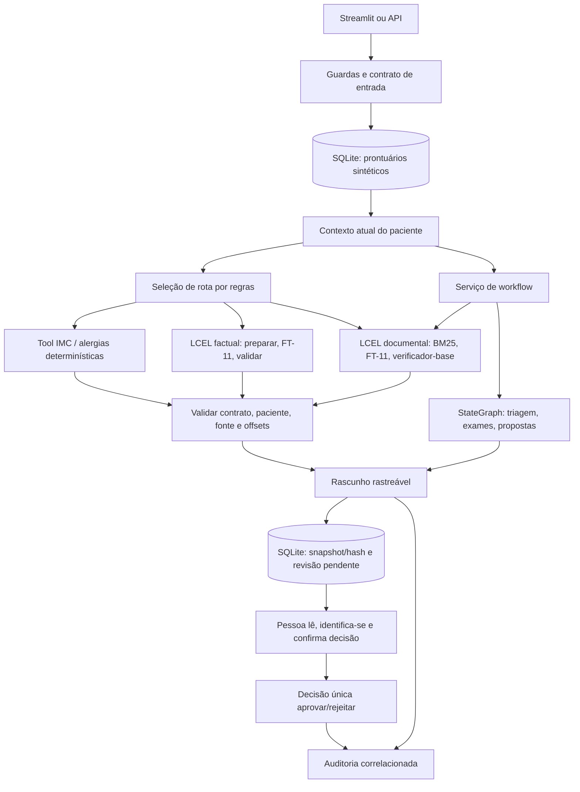
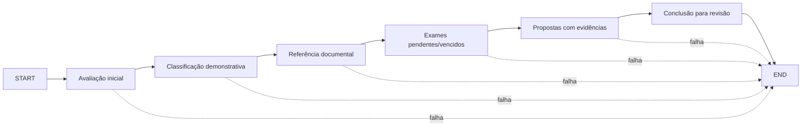

# Relatório técnico — Fase 3

Atualização: 16/10/2026. Protótipo acadêmico para médicos/equipe assistencial, com dados sintéticos e fontes públicas. Este documento descreve o código efetivo e seus testes; não certifica segurança clínica, conformidade integral com LGPD ou prontidão para produção.

## Atendimento ao enunciado

| Requisito da proposta | Implementação e evidência |
|---|---|
| Fine-tuning com protocolos, FAQs, modelos de laudos, receitas e procedimentos | FT-10/FT-11 executados, corpora sintéticos/curados, manifests, pesos locais e avaliação base/adapter. Receitas são modelos sem autorização de prescrição. |
| Preprocessing, anonimização e curadoria | Módulos `llm/src/finetuning/data/`, agrupamento/splits, proveniência e exemplos anonimizados. Os dados hospitalares são simulados, não dados de uma instituição real. |
| Assistente LangChain e prontuário atualizado | LCEL documental/factual com FT-11, SQLite relido por consulta e contratos tipados de contexto/fontes. |
| Fluxos LangGraph | StateGraph compilado de seis nós, com estado isolado e transições condicionais de falha. UI/API utilizam serviço integrado. |
| Limites, explicabilidade e rastreamento | Guardas de entrada/saída, fontes e offsets, logs correlacionados, snapshots/hash e revisão explícita persistente. |
| Organização, instruções e exemplos no Git | Pacotes por responsabilidade, dois SDKs, testes, datasets permitidos, evidências selecionadas e READMEs. Pesos e bancos são locais. |
| Relatório, diagrama e avaliação | Este relatório e resultados históricos referenciados abaixo. |
| Vídeo até 15 minutos | [Roteiro preparado](ROTEIRO_VIDEO.md); gravação/apresentação ainda pendentes. |

Os componentes de desenvolvimento identificados na revisão anterior foram implementados. Isso não equivale a validar todas as perguntas médicas nem concluir a gravação da entrega. [Proposta original](../PROPOSTA.md) e [plano com histórico](PLANO_EXECUCAO.md).

## Arquitetura efetiva

O SDK API/interface usa `langgraph==1.2.11` e `langchain-core==1.6.4`. O SDK LLM usa `langchain-core==1.4.0`, conforme o recibo congelado do RAG; são processos independentes, comunicados por HTTP local. A aplicação não importa o PyTorch no processo Streamlit. O runtime em `127.0.0.1:8001` carrega base/adapter uma vez e serializa consultas, pois o verificador alterna o estado PEFT.

O chat não é um agente autônomo de ferramentas. Expressões reconhecidas no código selecionam IMC/alergia, fatos de paciente ou documentos. A única tool do catálogo é `calcular_imc`; o cálculo continua determinístico. Não há geração livre de SQL, prescrição, diagnóstico definitivo ou rota geral de conhecimento sem documentos. O código legado de `/query` com Ollama permanece separado do chat FT-11.

### Fluxo LangGraph

`workflow_service.py` consulta prontuário, sinais, histórico e exames reais cadastrados, obtém resposta documental e invoca o grafo. Cada execução começa com estado novo; cada nó trabalha sobre uma cópia, evitando vazamento entre pacientes e chamadas concorrentes. Os exames vencidos/pendentes seguem os estados cadastrados; a prioridade usa regras demonstrativas, sem validação clínica. Sem documento pertinente, o caminho integrado pede completar evidências, sem inventar conduta. Os métodos de demonstração da classe mantêm compatibilidade; a UI/API usa o serviço com contexto e fontes.

## Dados e preparação

Há três conjuntos distintos:

- Prontuários: SQLite local, com paciente, alergias, medicamentos, consultas, exames, histórico e sinais vitais. Nome pode mudar sem reescrever relações por ID. A base customizada tem 11 pacientes sintéticos; `seed_patients.py` conserva os IDs renomeados conhecidos e não duplica esses perfis.
- Treinamento: exemplos sintéticos das cinco categorias exigidas e perguntas públicas selecionadas/traduzidas, com proveniência. Não se usa o banco atual como memória do modelo. Alterações no prontuário entram na próxima consulta, sem retreino.
- Documentos: catálogo/manifesto e índice BM25 congelado. São nove documentos elegíveis em 15 seções. As páginas oficiais admitidas são portarias, sem anexos clínicos; o restante inclui modelos/procedimentos sintéticos. Não se deve apresentar isso como base hospitalar clínica completa.

FT-10 usa `contextual_v1` com 960/120/120 exemplos. FT-11 usa `factual_v2`: 1.408 treino, 160 validação, 160 teste e desafio de 40. No treino, 1.024 são questões factuais e 384 atividades contextuais. As categorias incluem protocolo, FAQ, laudo, modelo de receita e procedimento; os modelos não são documentos médicos válidos para uso assistencial.

A preparação fixa seed 42, registra hashes e agrupa condições/sinônimos/CUIs para separar os conjuntos; também confere comprimento e EOS. Isso reduz vazamento conhecido, sem garantir ausência absoluta de memorização ou exposição prévia do modelo-base. A curadoria e as revisões semânticas são parcialmente por IA/amostrais, sem validação clínica.

Atribuição: a parte externa deriva de MedQuAD, por Asma Ben Abacha e Dina Demner-Fushman, revisão `577bd37b96c02d1833b2c9eed2de9f96964e96cb`, CC BY 4.0; tradução vinculada a `recogna-nlp/drbode_dataset`, revisão `5ce2ec87299adef39602d664209f79ed5914881a`, licença declarada MIT. Links, transformações e origem por exemplo estão no [README LLM](../llm/README.md) e nos manifestos. MedPT e ensaios posteriores são históricos; não compõem os pesos FT-11 selecionados.

## Fine-tuning realizado

Base `Qwen/Qwen3.5-9B`, revisão `c202236235762e1c871ad0ccb60c8ee5ba337b9a`, licença Apache-2.0 conforme manifesto local. Ambiente Linux/Python 3.14.4, AMD RX 9060 XT 16 GiB, ROCm, Transformers/PEFT/bitsandbytes. Não houve novo treinamento nesta integração.

FT-11 continua FT-10 com QLoRA NF4/BF16, embeddings congelados BF16, LoRA r=8/alpha=32/dropout=0,1; uma época, LR 1e-5, comprimento máximo 512, batch 1, acumulação 8, AdamW e gradient checkpointing. Foram 176 etapas em aproximadamente 3.541 s; loss treino 0,2470 e validação 0,0968. Loss não mede verdade clínica.

O adapter final foi salvo e recarregado em processo novo. SHA-256 dos pesos: `6d050564ef3979d75066aabb7eec4eeedc78488fe52491d5ee9012db1478946b`. A seleção foi feita na validação antes de abrir o teste reservado. Manifesto: `llm/artifacts/adapters/20261005T120430Z_qwen3.5_9b_qlora_rocm/manifest.json`; `best_model.json` identifica o escolhido. A [revisão FT-11](../llm/artifacts/experiments/20261005T120254Z_factual_v2/review.md) preserva critérios, falhas e decisões.

Comandos de preparação, treino FT-10/FT-11 e avaliação estão no [README LLM](../llm/README.md). Reproduzir a receita em outra execução não garante pesos idênticos nem permite reutilizar o recibo histórico como aprovação da nova versão.

## Avaliação e resultados

### Modelo adaptado

Teste reservado principal, prompt e decodificação equivalentes:

| Medida | Base 9B | FT-11 |
|---|---:|---:|
| Factual adequado | 20/48 | 22/48 |
| Factual parcial | 7/48 | 15/48 |
| Factual inadequado | 21/48 | 11/48 |
| Documentos/contexto: acerto completo | 29/112 | 100/112 |
| Alertas | 6/8 | 8/8 |
| Recusas | 8/8 | 8/8 |

FT-11 gerou JSON válido em 160/160, mas errou integralmente 12 tarefas documentais/contextuais e 11 perguntas factuais. Na prova adicional, houve regressão de adequados: FT-11 5/12 contra base 6/12, com 3 inadequados contra 5. O ganho contextual é claro nesses casos; não demonstra superioridade universal ou não inferioridade estatística. A revisão com rótulos ocultados por caso foi documental por IA, não clínica. Resultados completos e respostas brutas estão na execução FT-11 selecionada.

### Piloto documental

[RAG-09 final](../llm/artifacts/experiments/20261012T184438077141Z_rag09_test/review.md), 160 registros entre quatro condições:

| Medida | FT-11 + RAG | Base + RAG |
|---|---:|---:|
| Respondíveis completas | 19/24 | 18/24 |
| Parciais / inadequadas | 2 / 3 | 3 / 3 |
| Ausências | 8/8 | 8/8 |
| Conflitos | 4/4 | 4/4 |
| Instruções hostis | 4/4 | 4/4 |

Todos os 24 spans esperados chegaram ao contexto e as citações tiveram offsets exatos no ensaio. Persistiram abstenções indevidas e respostas parciais. A mediana FT+RAG foi 8,37 s por pergunta, sem carga, e o pico alocado 7,92 GiB. Orçamento 3.072 tokens com reserva 256. Isso é resultado da combinação modelo, decodificação restrita, resolução literal e verificação; não uma garantia do modelo isolado. O modo sem RAG era extrativo sem fontes, não teste de conhecimento geral.

O teste v5 está consumido. Recibos anteriores reprovados/revogados permanecem históricos; não devem ser reclassificados ou repetidos como testes novos. Módulos, índice, versões e identidade são conferidos pelo recibo atual. A nova cadeia factual de prontuário é separada e não herda automaticamente essas métricas.

### Integração atual

Em 16/10/2026, execução `20261016T101610484760Z_delivery_live`: **6/6 verificações com FT-11 real** — medicamento, exame vencido, consulta futura, signatários da portaria, bloqueio antes da LLM e workflow com fontes/revisão pendente. Não houve aprovação humana automatizada. [Resumo da execução](../llm/artifacts/experiments/20261016T101610484760Z_delivery_live/summary.json); respostas operacionais com dados de pacientes continuam locais.

Verificação final de software: **82 testes API/UI + 124 testes LLM aprovados**. Incluem grafo compilado, estado entre execuções/concorrência, dados estruturados, offsets, bloqueios, falhas, API, formulário, revisão única, paciente divergente e adulteração de snapshot. Backend de modelo mockado nos testes de software; não são 206 testes de qualidade clínica. Uma cópia temporária somente dos 823 arquivos selecionados (aproximadamente 13,45 MB) também passou nos mesmos 82 + 124 testes com os SDKs existentes, sem pesos carregados. Os oito módulos congelados, decisão e configuração tiveram hashes conferidos. Permanecem avisos de depreciação das dependências. Comandos e roteiro manual no [guia de validação](GUIA_VALIDACAO.md).

## Fontes, revisão e auditoria

Cada fonte contém ID, tipo, documento/paciente, versão, trecho e intervalo de caracteres. Os contratos exigem que o trecho corresponda ao intervalo e a resposta informativa aponte para fonte fornecida. Fontes de prontuário de outro paciente são rejeitadas. A cadeia factual permite ao FT-11 escolher evidência fornecida ou ausência; a resolução dos valores é literal no servidor. Isso limita invenções, mas não certifica atualidade/correção clínica do dado cadastrado.

Os rascunhos são gravados em `data/reviews.db` com conteúdo imutável/hash, paciente, consulta e estado pendente. Aprovação exige elegibilidade, fonte válida, identificação e confirmação explícita; rejeição também é registrada. Uma decisão já tomada não pode ser sobrescrita pelo endpoint. Não há autenticação, assinatura digital ou validação de registro profissional: identidade é declarada. Ensaios de aprovação aconteceram apenas em bases temporárias; os rascunhos reais deste teste ficaram pendentes.

`logs/audit.log` registra resposta completa, fontes, modelo, query_id, patient_id, review_id, workflow e evento de decisão/hash. Logs e bancos ficam locais. A integridade do snapshot detecta alterações no registro, mas não representa mecanismo de segurança contra administrador que controla arquivo e código. Os bloqueios são lexicais, não defesa completa contra toda prescrição indireta ou prompt injection.

## Reprodução e seleção para o Git

[README principal](../README.md) informa instalação, inicialização do runtime/Streamlit/API, seed e testes. Os dois SDKs são separados e suas versões não devem ser unificadas. Pesos/adapters não possuem distribuição pública própria registrada: copiar a execução original ou reproduzir treino/avaliação. Os manifestos contêm caminhos absolutos; transferir uma identidade exige preservar caminhos canônicos ou produzir nova verificação, sem editar hashes para contornar o gate. A execução foi validada neste ambiente existente, não em uma instalação limpa de outro computador.

O [manifesto de versionamento](../llm/artifacts/versioning_policy.json) seleciona código, testes, corpora permitidos, sete execuções completas e relatórios históricos de decisão. SDKs, pesos, bancos, caches e saídas operacionais permanecem locais. A seleção acadêmica substitui a anterior de runtime mínimo, atendendo ao pedido atual e à página 4 da proposta. Nenhum commit/publicação é feito automaticamente.

[AGENTS.md](../AGENTS.md) especifica responsabilidade e atualização de cada documento. A [revisão documental](REVISAO_DOCUMENTACAO.md) distingue instruções atuais de relatórios históricos imutáveis. Para fechar a entrega acadêmica, ainda é necessário gravar/apresentar o vídeo. A participação de um profissional para revisão clínica real não pode ser fabricada por testes ou código.
