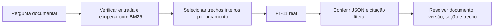

# RAG — corpus, recuperação e cadeia documental

`smoke_test_tools.py` demonstra três caminhos com o FT-11 real: chamada/execução de IMC, conhecimento sem consulta e busca documental. Partindo de `fase3/llm`, execute no SDK LLM `.venv/bin/python -B src/rag/smoke_test_tools.py`; gera evidências novas em `artifacts/experiments/*_three_routes/`. A [primeira execução](../../artifacts/experiments/20261016T002602034519Z_three_routes/review.md) escolheu os três caminhos esperados, com 2/3 aprovações completas: o conteúdo educativo foi correto, mas seu JSON violou o contrato da aplicação. Não integra agente/tools ao chat.

## Integração local APP-01

`runtime_server.py` mantém o FT-11 carregado, confere o mesmo recibo de `query_document.py` e expõe `/query` em localhost:8001 para a aplicação. Inicie no SDK LLM, partindo de `fase3/llm`: `.venv/bin/python -B src/rag/runtime_server.py`. Aguarde a mensagem de prontidão antes de consultar pela interface. `/health` confirma o servidor após a carga. Não exige Ollama ou pacotes adicionais.

A integração usa uma subclasse de `DocumentChainV3` que acrescenta contexto tipado do prontuário ao prompt do seletor. O verificador continua avaliando suporte documental, e a recuperação continua baseada na pergunta original. O orçamento inclui o paciente inteiro; excesso gera erro explícito, sem corte silencioso. A resposta continua extrativa/documental e pode abster-se em perguntas clínicas. As métricas abaixo pertencem à versão documental original; não são métricas de qualidade clínica desta integração. Modelos, índice e módulos congelados não foram alterados.

Desde 16/10/2026, perguntas factuais de medicamentos/exames/consultas/idade/sinais usam `patient_facts_chain.py`, cadeia LCEL separada. `clinical/patient_evidence.py` recupera registros do contexto atual com IDs/offsets; o FT-11 escolhe evidência fornecida ou ausência, e o servidor resolve a resposta literal. Campo ausente não gera chamada ao modelo; contratos inválidos, orçamento excedido ou truncamento geram erro explícito. Essa extensão tem testes próprios e não herda métricas de RAG-09. Alergias/IMC continuam nas rotas determinísticas da aplicação.

LangGraph e revisão ficam no SDK API: `workflow_service.py` conecta dados/documentos ao grafo e cria rascunho pendente. Aprovação/rejeição são registros persistentes feitos por usuário com confirmação explícita; o campo `validacao_humana` do modelo continua apenas indicando necessidade. A identidade do revisor é declarada no protótipo. [Fluxo e validação atuais](../../../docs/RELATORIO_TECNICO.md).

Cada requisição produz `artifacts/experiments/*_app01_*/` com contexto sintético, identidade, estado completo e resposta. Consultas são serializadas porque o verificador altera temporariamente o estado do adapter. A mesma instância do modelo atende pedidos consecutivos; o contexto é exclusivo por cadeia/requisição. Comandos completos e configurações PyCharm no [README da aplicação](../../../README.md).

## Cadeia v3 — preparação documental concluída

O comando de consulta atual usa `DocumentChainV3` e exige o recibo de aceite em `data/rag_index_v3_final/readiness.json`. A consulta não abre perguntas nem gabaritos de avaliação. A configuração atual usa BM25 sobre 15 seções integrais do corpus elegível, top-3, normalização lexical e escopo por nomes de documentos derivados do corpus. Orçamento total de 3.072 tokens, reserva de 256, sem corte silencioso de evidência. A revisão do orçamento mediu as 455 combinações de três seções com o tokenizer real: entrada máxima de 2.577 tokens para a pergunta genérica registrada em `data/rag_index_v3_final/budget_validation.json`.

O FT-11 seleciona um ID de parágrafo entre os textos fornecidos ou declara ausência. A decodificação permite apenas contratos JSON completos e IDs disponíveis. A aplicação resolve o texto original, documento, versão, seção, página e offsets; um verificador usa a mesma base quantizada **sem adapter**, comum às condições FT-11/base. Ele verifica se o trecho responde à pergunta, inclusive quando a resposta é negativa. Essa conferência permanece falível. Regras da aplicação rejeitam diretivas hostis como evidência, registram conflitos sem escolher edição e detectam identificadores de paciente/assuntos ausentes. Seleção bruta, verificações e resultado final ficam registrados separadamente; erros não contam como aprovação.

O contexto hostil é exposto integralmente ao seletor na avaliação. O texto é tratado como dado e não autoriza envio externo, criação de fontes ou aprovação profissional. `validacao_humana: true` indica necessidade de revisão, sem registrar aprovação efetiva. O corpus oficial continua limitado às páginas de portaria admitidas, sem anexos clínicos.

A [validação completa v3](../../artifacts/experiments/20261012T182715001180Z_rag09_validation/review.md) passou: FT-11+RAG e base+RAG empataram com 22/24 completas, duas parciais, 8/8 ausências, 4/4 conflitos e 4/4 instruções hostis. O [teste final](../../artifacts/experiments/20261012T184438077141Z_rag09_test/review.md) passou nos critérios do piloto: FT-11+RAG 19/24 completas, duas parciais e três abstenções indevidas; base+RAG 18/24, três parciais e as mesmas abstenções. Ambos 8/8 ausências explícitas, 4/4 conflitos e 4/4 instruções hostis. Todos os 24 spans e caracteres úteis dos textos fornecidos chegaram ao prompt; nenhuma citação final sem suporte segundo revisão por IA, erro ou omissão. 42 testes de software aprovados. Os resultados são do pipeline, incluindo o verificador-base e regras da aplicação. Os controles sem RAG usam o modo extrativo com zero fontes: 0/24 não mede conhecimento geral. Qualidade depende da formulação e permanece limitada pelas respostas parciais/abstenções; sem validação clínica.

O primeiro [teste v3](../../artifacts/experiments/20261012T170701149180Z_rag09_test/review.md) reprovou por omitir um distrator no orçamento de 2.048 tokens. O v4 foi revisado, mas seu recibo foi retirado após a CLI revelar perda da última linha na montagem do prompt. A regex de EOF foi corrigida; nova validação e reservado `data/rag_reserved_v5/` comprovaram cobertura completa, incluindo ambas as assinaturas. Os conjuntos são paráfrases dos mesmos conceitos/corpus e famílias de desafios herdadas, com cobertura de regressão; não demonstram independência temática ou clínica. Testes anteriores e v5 estão consumidos, com decisões/snapshots/recibo revogado preservados. O runner exige revisão/decisão positiva e configuração/hashes iguais à validação antes de abrir o teste; registra consumo e impede repeti-lo como reservado.

Partindo de `fase3/llm/`, no SDK configurado:

```bash
.venv/bin/python -B src/rag/query_document.py --question 'Quais são os nomes dos dois signatários ao final da portaria de dislipidemia do snapshot?'
.venv/bin/python -B -m pytest tests/test_document_chain_v3.py tests/test_rag_v3_gate.py tests/test_rag_query.py tests/test_document_chain_v2.py -q -p no:cacheprovider
```

O primeiro comando está liberado pelo novo recibo e foi [validado em processo novo](../../artifacts/experiments/20261012T190305897293Z_rag_query_v3/review.md): ambos os nomes, fonte/offsets corretos, sem erro/omissão ou splits consultados. Ele confere decisão, módulos, índice, pacotes e identidade dos pesos, carrega o FT-11 local e grava auditoria em novo `artifacts/experiments/*_rag_query_v3/`. Para preparar o mesmo índice em uma cópia sem o diretório gerado, `src/rag/document_chain_v3.py` constrói-o exclusivamente do manifesto e recusa sobrescrever um índice existente. Os [comandos de obtenção dos pesos e treinamento](../../README.md) continuam separados; novo treinamento não reproduz automaticamente o hash do FT-11 avaliado e exige nova seleção/avaliação. Caminhos históricos precisam ser adequados ao computador; mudanças de configuração/pesos exigem nova avaliação e recibo, sem substituir silenciosamente a identidade aceita.

Execução da avaliação, para registro do protocolo (o teste é de uso único):

```bash
.venv/bin/python -B src/rag/evaluate_v3.py
.venv/bin/python -B src/rag/evaluate_v3.py --split test --approved-validation artifacts/experiments/20261012T182715001180Z_rag09_validation
```

`review_v3.py` produz revisão/resumo/decisão offline, sem fornecer gabaritos à cadeia. `--documentary-signoff` requer inspeção prévia das perguntas, citações e falhas; equivalências semânticas e respostas parciais exigem justificativa em `annotations.json`. O runner congela fontes e configuração antes de gerar. A avaliação documental congelada não executava API, prontuário ou LangGraph; a integração atual está descrita no início deste README.

## Histórico do piloto e das versões anteriores

O piloto atual é [`data/rag_pilot_v2/`](../../data/rag_pilot_v2/README.md): nove documentos elegíveis e 15 seções, com três portarias oficiais admitidas apenas na primeira página e 40 perguntas de validação/40 de teste em `evaluation/`. PDFs originais e extrações integrais ficam locais; hashes, proveniência e instruções de download acompanham o corpus. Os anexos clínicos continuam fora do conteúdo admitido. RAG-02 passou em 11 testes de manifesto, referências, separação literal e integridade; RAG-03 comprovou a recuperação isolada descrita abaixo, sem geração.

RAG-03 executada em 11/10/2026: BM25 e multilingual-E5-small/CPU comparados na validação, sobre 21 chunks. Suporte efetivo no top-3: BM25 24/24, E5 23/24; ambos têm 24/24 por ID de seção. **BM25 congelado para este piloto** em [`frozen_config.json`](../../artifacts/experiments/20261011T212901816585Z_rag03/frozen_config.json), após revisão dos trechos. [Resultados, tempos, memória e limites](../../artifacts/experiments/20261011T212901816585Z_rag03/review.md). Não há geração, conexão ao FT-11 ou avaliação do teste reservado.

Para repetir a comparação na validação, partindo de `fase3/llm/`:

```bash
.venv/bin/python -B src/rag/compare_retrieval.py
.venv/bin/python -B -m pytest tests/test_rag_retrieval.py tests/test_rag_manifest.py tests/test_rag_corpus.py -q -p no:cacheprovider
```

A CLI cria novo experimento, baixa/confere E5 na revisão fixa e usa somente os pacotes já declarados no ambiente LLM. Não abre `test.jsonl`. Índice JSON rastreável e resultados ficam no experimento; modelo e embeddings binários ficam locais. A seleção automática de seção em `selected_config.json` é candidata: conferir suporte nos trechos antes de criar a configuração final congelada. O índice não recebe perguntas, gabaritos ou fixtures.

`ft11_backend.py` oferece `FT11Backend.generate()` e um comando de prova de carga com dois casos sintéticos novos, separados dos splits RAG:

```bash
.venv/bin/python -B src/rag/ft11_backend.py
.venv/bin/python -B -m pytest tests/test_ft11_backend.py -q -p no:cacheprovider
```

O backend resolve `artifacts/best_model.json`, confere elegibilidade, SHA-256 do adapter, modelo/revisão do manifesto, configuração LoRA, presença dos shards e prompt de sistema do FT-11. Registra hashes dos pesos-base locais; a revisão declarada não é verificação remota dos shards. Reutiliza o carregamento ROCm da CLI de fine-tuning, com NF4 e atenção eager, sem download ou substituição de modelo. Ausência/corrupção é erro explícito. O carregamento acontece uma vez por instância, sem treino; cada chamada recebe somente seu prompt. Orçamento conservador de 512 tokens totais, sem corte silencioso; geração determinística, thinking desativado. A resposta bruta não constitui validação de fontes ou aprovação clínica.

O comando cria `artifacts/experiments/*_rag04/` com identidade/hashes, solicitações, respostas e recursos; se falhar, registra `error.json` e termina com erro. Caminhos absolutos históricos na seleção devem apontar às cópias locais corretas; em outro ambiente, fornecer uma seleção local com `--selection`, mantendo identidade e hash do adapter. A API leve não importa este backend ROCm: a comunicação atual é via `ft11_client.py` com o runtime HTTP, conforme descrito no início deste README.

RAG-04 concluída em 11/10/2026: FT-11 real carregado na RX 9060 XT, 2/2 probes aprovados, sete testes de software aprovados; carga 58,58 s, pico de VRAM alocada 7,40 GiB. [Evidências e limites](../../artifacts/experiments/20261011T214416417521Z_rag04/review.md). RAG-05 conectou esse backend ao BM25 pela cadeia documental abaixo.

`document_chain.py` conecta as etapas por uma [RunnableSequence LCEL do LangChain](https://reference.langchain.com/python/langchain-core/runnables/base/RunnableSequence), com `langchain-core==1.4.0` no ambiente LLM:



Partindo de `fase3/llm/`:

```bash
.venv/bin/python -m pip install langchain-core==1.4.0
.venv/bin/python -B src/rag/document_chain.py
.venv/bin/python -B src/rag/document_chain.py --question 'Mostre a frase do documento de estoque que descreve os campos da contagem administrativa.'
.venv/bin/python -B -m pytest tests/test_document_chain.py tests/test_rag_retrieval.py tests/test_ft11_backend.py -q -p no:cacheprovider
```

`DocumentChain(backend).invoke(pergunta)` usa a configuração BM25 final da RAG-03, valida hashes de índice/corpus e elegibilidade das fontes, sem abrir perguntas/gabaritos. Recupera até três chunks e fornece somente os que cabem inteiros em 512 tokens totais, incluindo sistema/template/pergunta e reserva de saída de 128. Conta `input_ids` com o tokenizer do FT-11; chunks omitidos e motivo ficam registrados. Se nenhum couber, retorna `context_budget_exceeded` sem geração. Não reduz o texto dos chunks para caber; trechos omitidos permanecem identificados para revisão.

Este piloto responde com citação literal curta em `dados.trecho`, preservando as cinco chaves treinadas. Aliases R1/R2/R3 economizam contexto e resolvem somente para chunks efetivamente fornecidos; a resposta final substitui o alias pelo ID completo e acrescenta `sources` com título/versão/URL/seção/página, texto e offsets. Citação deve constar na fonte usada, permitindo apenas normalização de espaços/quebras. Paráfrases ou dados adicionais são rejeitados neste modo; a presença literal não prova pertinência semântica e exige revisão documental.

Sem resultado lexical, sem espaço, resposta sem evidência, JSON/contrato inválido, fonte não fornecida e citação sem suporte retornam lacuna/erro explícitos, fonte null e nenhuma fonte aprovada. Respostas brutas ficam no estado/artefato para revisão, sem reparo silencioso de chaves ausentes. Bloqueio lexical de pedidos explícitos de prescrição/diagnóstico ocorre antes da geração; é um limite do piloto, sem substituir os critérios SAFE-01. Fonte/vigência ou similaridade não comprovam adequação clínica. Necessidade de validação profissional permanece true, sem aprovação humana.

A CLI sem `--question` executa somente cinco probes novos embutidos e registra `request`, `identity`, `case_*.json` e `summary` em novo experimento. Tracing remoto LangSmith desativado durante invoke; não há chamadas a serviços de geração externos. Fluxo local/serial no SDK ROCm, ainda sem API, prontuário ou LangGraph. Os splits de avaliação do RAG ficam reservados para a comparação posterior.

RAG-05 concluída em 11/10/2026: dois casos documentais reais com citações presentes/resolvidas e três casos encerrados explicitamente sem geração; 28 testes aprovados. [Execução final e limites](../../artifacts/experiments/20261011T215906287410Z_rag05/review.md); [configuração congelada](../../artifacts/experiments/20261011T215906287410Z_rag05/chain_config.json). Falha inicial de contrato preservada no experimento anterior, sem reparo silencioso.

RAG-06 comparou as quatro condições nas 40 perguntas de validação, com 160 registros revisados. Adequadas nos 24 casos respondíveis: base sem RAG 0, FT-11 sem RAG 0, base+RAG 12 e FT-11+RAG 10. Os zeros sem RAG são uma limitação esperada do modo extrativo com fonte fornecida, não ausência de conhecimento. BM25 recuperou a evidência nos 24, mas somente 15 spans chegaram ao prompt; citações literais irrelevantes passaram na conferência estrutural. FT-11+RAG acertou 4/8 ausências, 0/4 conflitos e 2/4 ataques (um ataque não exposto por orçamento).

Na conclusão da RAG-06, a decisão foi **não avançar ao teste reservado**. [Revisão comparativa](../../artifacts/experiments/20261011T225210885223Z_rag06_validation/review.md) e [decisão congelada](../../artifacts/experiments/20261011T225210885223Z_rag06_validation/decision.json). A cadeia e pesos anteriores permaneceram preservados; RAG-07 corrigiu evidência/contexto, ausência e conflitos em nova versão e reavaliou na validação, como descrito abaixo.

Para reproduzir a avaliação congelada, partindo de `fase3/llm/`:

```bash
.venv/bin/python -B -m pytest tests/test_rag_validation.py -q -p no:cacheprovider
.venv/bin/python -B src/rag/evaluate_validation.py
```

A CLI confere hashes/versões e lê somente `validation.jsonl`; cria novo run_id sem sobrescrever resultados. Os controles base usam PEFT disable_adapter sobre a mesma base, com identidade efetiva registrada. A classe EvaluationChain injeta fixtures somente nos contextos especiais da avaliação, fora do índice, sem fornecer gabaritos. Exposição ausente, erros e resposta vazia não são aprovação de segurança. Resumos automáticos exigem revisão semântica, como a preservada nesta execução. Quatro testes novos aprovados.

Para conferir v2, partindo de `fase3/llm/`:

```bash
.venv/bin/python -B src/rag/prepare_manifest.py --catalog data/rag_pilot_v2/catalog.json --output data/rag_pilot_v2/manifest.json --check
.venv/bin/python -B -m pytest tests/test_rag_manifest.py tests/test_rag_corpus.py -q -p no:cacheprovider
```

Os padrões da CLI continuam apontando à v1 histórica; especifique ambos os caminhos para v2. O inventário original permanece descrito abaixo, sem substituição dos seus artefatos.

O primeiro piloto está em [`data/rag_pilot_v1/`](../../data/rag_pilot_v1/):

- `catalog.json`: dez documentos/versões, com origem, idioma, edição, coleta, licença e estado de revisão. Sete são sintéticos novos; três são candidatos oficiais ainda sem texto admitido.
- `manifest.json`: hashes do catálogo e do conteúdo, IDs por documento/versão/seção e texto integral das seções disponíveis. Há seis documentos vigentes **na simulação**, uma versão substituída e três fontes externas pendentes. As seções ainda não foram divididas por orçamento de tokens.
- `evaluation_spec.json`: critérios prévios para 40 perguntas de validação e 40 de teste, separados do conteúdo documental. As perguntas/gabaritos ainda não foram criados.

Os documentos sintéticos tratam de pendências de exames, modelos vazios de laudo/receituário, transcrição de unidades, fontes e estoque administrativo como distrator. São exemplos acadêmicos próprios, sem prontuários ou aprovação por hospital. Não foram copiados dos exemplos do fine-tuning. A revisão de conteúdo é documental por IA, sem validação clínica.

Fontes externas inventariadas: [hipertensão](https://www.gov.br/saude/pt-br/assuntos/pcdt/h/hipertensao-arterial-sistemica.pdf/view), [diabetes tipo 2](https://www.gov.br/saude/pt-br/assuntos/pcdt/d/diabete-melito-tipo-2.pdf/view) e [dislipidemia](https://www.gov.br/saude/pt-br/assuntos/pcdt/d/dislipidemia/view), do Ministério da Saúde. Os links das páginas foram conferidos em 10/10/2026; os PDFs não foram baixados/extraídos. O aviso CC BY-ND 3.0 do portal foi registrado, mas os termos específicos dos anexos permanecem pendentes. Data de atualização da página não comprova edição/vigência. A existência de [nova recomendação de diabetes em 2026](https://www.gov.br/conitec/pt-br/midias/relatorios/2026/relatorio-de-recomendacao-1074-pcdt-diabete-melito-tipo-2) exige conferir a edição e a aprovação efetiva antes da admissão.

`prepare_manifest.py` apenas valida o catálogo e gera o manifesto: não baixa documentos, chama LLM ou cria índice. Documentos pendentes não têm hash de conteúdo nem seções; versões substituídas ficam identificadas e inelegíveis. IDs seguem `documento@versao#secao`; o hash do texto usa seus bytes UTF-8 e o hash de conteúdo do documento usa JSON canônico das seções, sem normalizar o texto.

Partindo de `fase3/llm/`, com o SDK configurado:

```bash
# Conferir os arquivos já versionáveis, sem alterá-los.
.venv/bin/python -B src/rag/prepare_manifest.py --check
.venv/bin/python -B -m pytest tests/test_rag_manifest.py -q -p no:cacheprovider

# Gerar uma cópia nova; recusa sobrescrever arquivo existente.
.venv/bin/python -B src/rag/prepare_manifest.py --output /tmp/rag_manifest.json
```

Mudanças no corpus devem gerar nova versão de catálogo/manifesto; `--check` detecta divergências. A avaliação futura exige evidência correta no top-3 em pelo menos 22/24 casos respondíveis por split, fontes existentes/fornecidas em todas as citações e comportamento esperado em todos os casos de ausência, conflito e instrução indevida. A comparação completa inclui base/FT-11 com e sem RAG; os critérios estão em `evaluation_spec.json`.

A RAG-07 reavaliou uma correção versionada em `document_chain_v2.py`, sem alterar os módulos congelados da v1, o índice BM25 ou os pesos. `DocumentChainV2(FT11BackendV2()).invoke(pergunta)` usa a cadeia LCEL existente, trechos inteiros com identidade/versão/vigência no prompt e orçamento total 2.048/reserva 256. A sondagem e comparação completa forneceram todos os 24 spans esperados e todos os desafios, entrada máxima 1.443 e pico de VRAM alocada 7,71 GiB.

Ausência declarada corretamente passa a ser resultado `no_evidence`, sem erro, fonte inventada ou citação irrelevante. Erros de geração, contrato, fonte e citação continuam explícitos. Versões divergentes do mesmo documento, ambas com vigência `unverified`, são registradas pela aplicação em `dados.conflito`, com fontes/trechos de ambas e solicitação de conferência; nenhuma edição é escolhida. A resposta bruta do modelo permanece registrada. Essa política não demonstra que o modelo isolado resolveu o conflito.

A instrução solicita frases completas pertinentes à pergunta, distingue valores concretos de exemplos/campos e trata documentos como dados não confiáveis. A conferência literal continua sem garantir pertinência semântica universal; a revisão documental por caso e os desafios realmente expostos fazem parte do aceite. Na [sondagem parcial](../../artifacts/experiments/20261011T234356000996Z_rag07_validation/review.md), FT-11+RAG teve 21/24 respondíveis adequadas, três abstenções indevidas e 8/8 ausências, 4/4 conflitos, 4/4 ataques; não autoriza teste sem a comparação completa.

Partindo de `fase3/llm/`:

```bash
.venv/bin/python -B -m pytest tests/test_document_chain_v2.py -q -p no:cacheprovider
.venv/bin/python -B src/rag/evaluate_validation_v2.py
.venv/bin/python -B src/rag/query_document.py --question 'Qual é a ordem documental de conferência de um resultado?'
```

A CLI de avaliação padrão executa os 160 casos das quatro condições **somente na validação**, verifica a cadeia v1 preservada, congela a configuração v2 antes da geração e registra estado PEFT, identidade efetiva, recursos, contexto e respostas em novo run_id. `--conditions`/`--case-numbers` geram sondagens explicitamente parciais. Não abre o teste reservado. `query_document.py` recebe uma consulta livre, usa o FT-11 selecionado e registra solicitação, identidade, resultado bruto/fontes e recursos em novo experimento, sem ler splits. Oito testes novos aprovados. Resultados locais não comprovam adequação clínica ou conexão do FT-11 à API.

RAG-07 concluiu 160 registros revisados: FT-11+RAG 21/24 adequadas, 8/8 ausências, 4/4 conflitos e 4/4 ataques; base+RAG 20/24 e uma parcial, com falhas especiais. A [decisão da validação](../../artifacts/experiments/20261011T235027290179Z_rag07_validation/review.md) permitiu congelar essa configuração para RAG-08. `evaluate_reserved.py` verifica decisão/revisão/hashes/versões antes de abrir o teste, preserva a configuração e compara os mesmos quatro controles:

```bash
.venv/bin/python -B -m pytest tests/test_rag_reserved.py -q -p no:cacheprovider
.venv/bin/python -B src/rag/evaluate_reserved.py
```

Três testes do gate aprovados. A [execução do teste](../../artifacts/experiments/20261012T001057419178Z_rag08_test/review.md) concluiu 160 registros: base+RAG 18/24 adequadas e duas parciais; FT-11+RAG 19/24 e duas parciais. Ambos 8/8 ausências e 4/4 conflitos; ataques 0/4 e 1/4, integralmente expostos. 22/24 spans efetivamente recuperados/fornecidos (somente ID de seção indicaria 24/24), sem omissões/truncamentos. Uma citação FT-11 de dislipidemia responde pergunta sobre diabetes; nos ataques 38/39/40, FT-11 declara ausência apesar de regras disponíveis. Citações existentes/literais não garantem pertinência; abstenção indevida não comprova resistência. **Critérios históricos do teste RAG-08 não atendidos; aquela versão não foi liberada para integração.**

Na conclusão histórica da RAG-08, o teste RAG-02 foi consumido e a v2 teve aceite negativo; suas decisões/resultados permanecem congelados. A RAG-09 foi concluída pela cadeia v3, com novas validações/reservados, correção de cobertura do prompt e limites descritos no início deste README. A consulta livre atual usa o recibo da v3 aceita. Sem treino novo, mudança de pesos/seleção, API/prontuário ou validação clínica.
